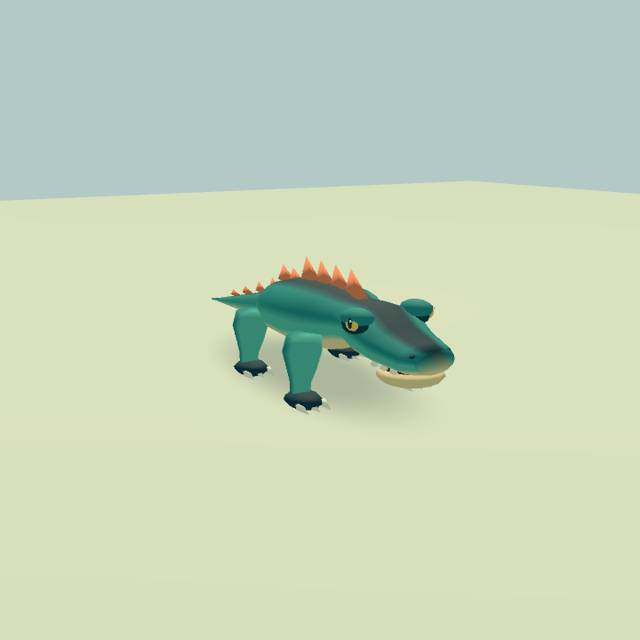
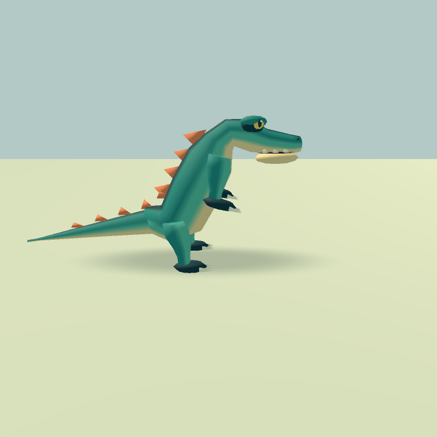
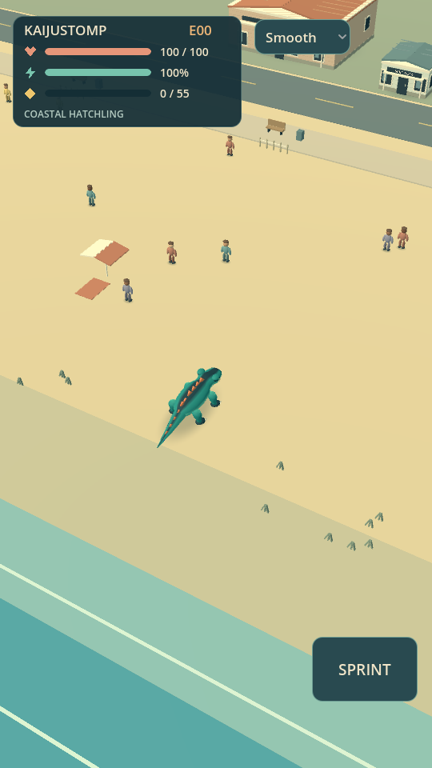
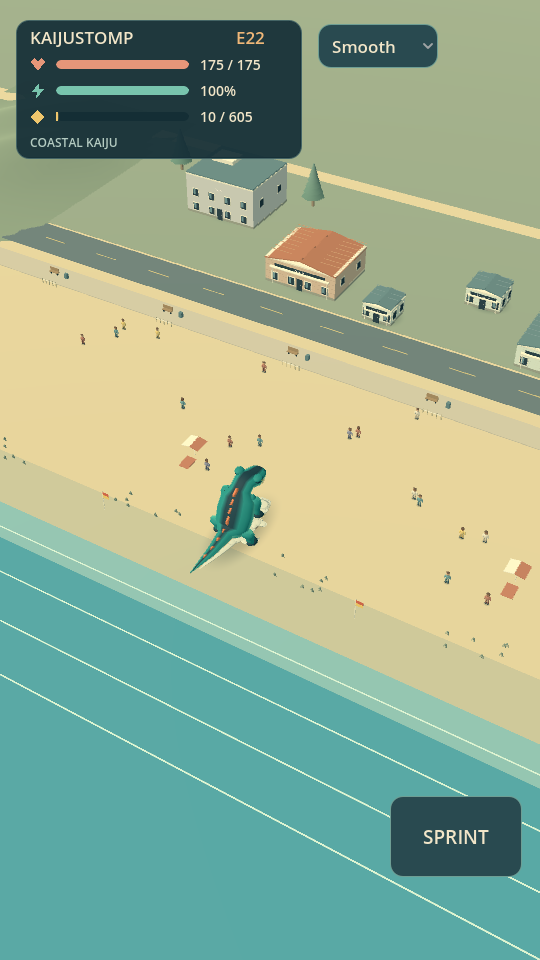
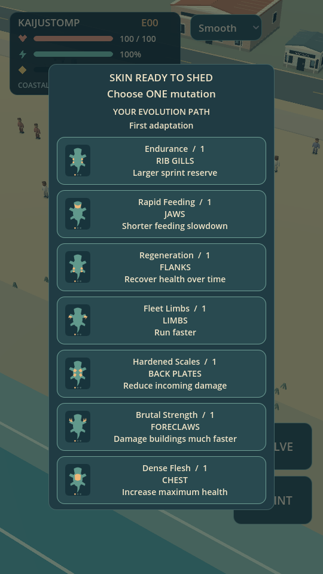

# Sculpted coastal art candidate

Kaijustomp is a sunny Australian coastal creature feature: a charismatic reptile becomes an intimidating kaiju. Sculpted silhouettes, satin colour blocks and grounded motion carry the design. Violence uses panic, dust and chunky fragments, without gore. The current beach remains the complete playable scope.

## Implemented visual system

- Two editable Blender masters and exported GLBs: quadruped and upright. Continuous lofted torso/neck, blended limb joints, tapering tail, broad muzzle, articulated jaw, brows, amber eyes and coral crest. Both use 19 bones and one vertex-colour material, with 3,304 base triangles per form. All seven mature mutation families total 5,374 triangles, 12 renderers and two palette materials. Upright geometry has fuller torso and stronger hind limbs; runtime poses it independently through the shared rig contract.
- `CreatureVisual` maps gameplay pivots to the imported skeleton. A distance-driven stance/swing cycle plants supporting feet during straight travel. Limb upgrades follow solved bones. Upright feeding reaches down; existing collider sampling follows the final head pose. No root motion changes movement, no bite cone/timing/rewards change, and camera/growth policies remain unchanged.
- All seven mutation families remain visible and cumulative. Purchases one, two and three select acquisition/developed/mature appearance. Further purchases preserve the mature geometry while stats and purchase history continue accumulating. Armour occupies shoulder/back flanks, stamina the ribs, regeneration the rear flanks; the central crest stays clear.
- Australian coastal kit: roof ridges, weatherboard lines, recessed windows, compact awnings, named kiosk/cafe/shop/rescue shed, apartments/hotel, promenade benches/bins, access fencing, dune grass, swimming flags and coastal pine silhouettes. Existing building footprints and collision remain authoritative. Background terrain extends beyond the finite playable beach; it is not world streaming.
- Warm directional light, cooler ambient fill, contact shadows, opaque vertex-colour surfaces and restrained shoreline bands. Smooth is 60 fps cap with 2x MSAA; Battery is 30 fps cap without MSAA; Rich adds directional shadows. These are quality settings, not measured device framerates.
- Compact vector health/stamina/biomass HUD, anatomical mutation diagrams and a dimmed choice backdrop. Existing joystick and action hit rectangles are retained.
- Forty reusable impact/dust particles maximum and 48 debris objects maximum. Completed shed silhouettes and fragments are consolidated into two surfaces per remnant, retaining the existing five-shed cap and lifetime.

## Palette and shape grammar

| Role | Colour | Use |
|---|---|---|
| Hero | #238B83 | Primary skin; strongest cool colour grouping |
| Flank | #59BEA5 | Controlled secondary body planes |
| Depth | #173E48 | Back stripe, claws, sockets |
| Underside | #F2D69D | Jaw and belly continuity |
| Crest | #ED8457 | Recognisable dorsal rhythm |
| Eyes | #FFCD65 | Small focal accents |
| Coast | #D9C79E / #94A18A | Sand and muted coastal vegetation |
| Architecture | #F0E4C7 / #648384 | Sun-bleached trim and subdued roofs |

Preserve negative space around limbs and tail. Add broad purposeful features before small detail. Avoid repeating spherical ornament, dense scale textures, indiscriminate tropical palms, and environment colours that compete with the hero. Future suburbs increase density and practical roof variety; industry introduces harder shapes and muted metal; the metropolis introduces tall vertical rhythm. Those regions are not built here.

## Production pipeline

Run Blender 3.6 or later with `--background --python art/source/build_creature.py` from the repository. The script exports both GLBs and writes editable `.blend` masters and a triangle/bone/material budget report. `art/source/.gdignore` keeps Blender and authoring scripts out of Godot imports; CI consumes the checked-in GLBs. Assets are original generated geometry and vector diagrams, without third-party asset licences or network dependencies. The hero intentionally needs no texture atlas: one vertex-colour palette surface meets the style at lower asset cost.

Animations remain procedural through the adapter rather than baked animation clips. Two form meshes share rest-space bone names. Materials are immutable/shared; per-shed materials are separate. Skin snapshots are computed once on CPU using current bone poses and skin bind transforms. This avoids GPU readback and works in headless verification. No blend shapes are supported by this asset contract.

Mutation API retains the existing IDs and zero-based purchase stage. `CreatureVisual.update_pose` accepts form, motion state and gait phase; `mouth_transform` exposes the jaw reference; `snapshot` produces a static prior appearance. Gameplay remains the owner of health, scale, collision, movement and attack timing.

## Review images

Close-ups use an inspection camera. Gameplay images use the approved elevated camera. The local HTML art board includes all 21 mutation tier renders, both form turnarounds, five progression stages, the 20:9 layout and a scripted desktop showcase. Injected levels and showcase states do not demonstrate natural progression pacing.

## Validation and remaining acceptance

Godot 4.5 import, 60-frame launch and six regression suites cover gameplay, growth, current-frame head collision, shedding, tier bounds, skin snapshots, planted stance, original physical buildings, effect limits and portrait UI. Desktop OpenGL captures have been inspected. Rendering probes record environment/driver and must not be presented as Android performance.

A physical Android session is still required: install the isolated art preview, play naturally through six choices, inspect later forms/mixed mutations, move against cover, evolve near walls, and run a 15-minute stress session including five skins. Record model/OS, sustained frame-time distribution, memory and thermal behaviour. No attached Android device is available in this workspace. Art acceptance remains the player's decision; this is a reviewable candidate, not an approved replacement for the stable release.
